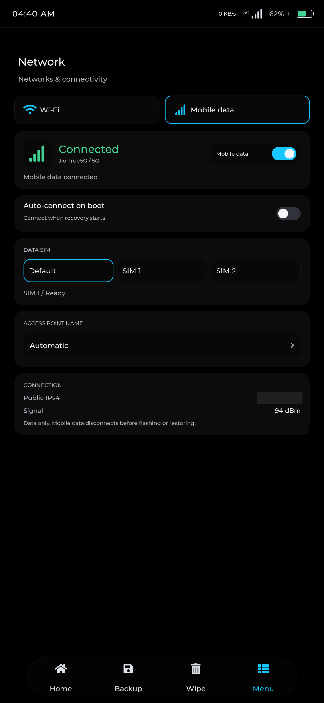
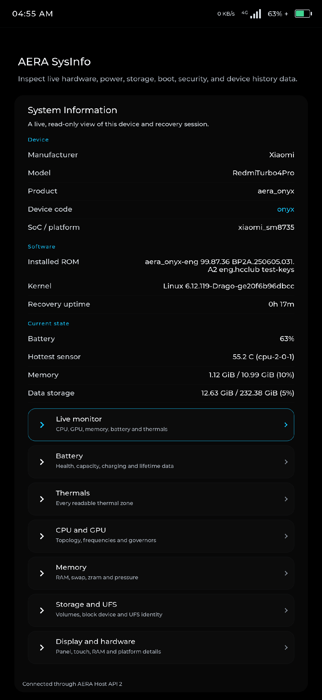
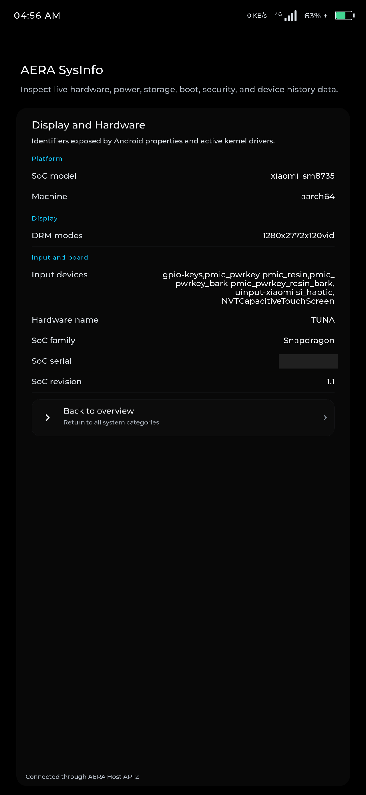

# AERA Recovery for POCO F7 / Redmi Turbo 4 Pro (onyx)

**Unofficial Beta / Unstable** · Maintainer Rohit Sharma (hcclubb)

- [Download the r6 test IMG and installer ZIP](https://github.com/ROHITSHARMA838888/AERA-Recovery-Unofficial-POCO-F7-onyx/releases/tag/onyx-r6-beta-unstable)
- [Developer handoff and build instructions](PORT-STATUS.md)
- [AERA upstream developer documentation](https://aera-recovery.com/wiki/)

The r6 test image booted on a POCO F7 running Yasvara with the Drago 6.12.119 kernel. Recovery UI and internal storage were usable, the plugin catalog refreshed, and cellular Internet and DNS passed after a clean boot. Jio and Vodafone Idea were tested. See the handoff for test scope, open issues and rollback details.

## On-device screenshots

| Mobile data | System information | Display and hardware |
| :---: | :---: | :---: |
|  |  |  |

**Build provenance:** r6 was built on ServerHive from an existing AERA checkout. A fresh Linux build from the published instructions and GitHub Actions at this release revision are still to be verified. See [developer handoff](PORT-STATUS.md#where-r6-was-built-and-tested).

**Test scope:** POCO F7, Yasvara, Drago 6.12.119, slot B. Redmi Turbo 4 Pro, Infinity-X touch, PIN-protected storage and Browser launch still need verification.

**Before flashing:** Verify the download with `sha256sum -c SHA256SUMS`, confirm the active slot, and keep a verified backup of that slot's recovery for rollback.
